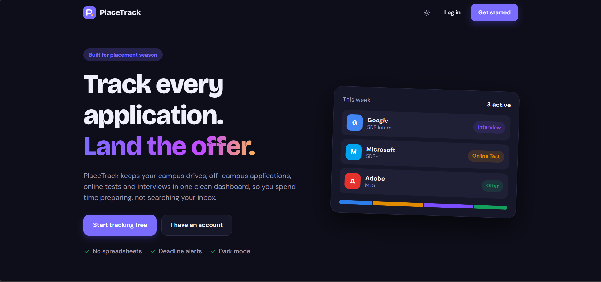
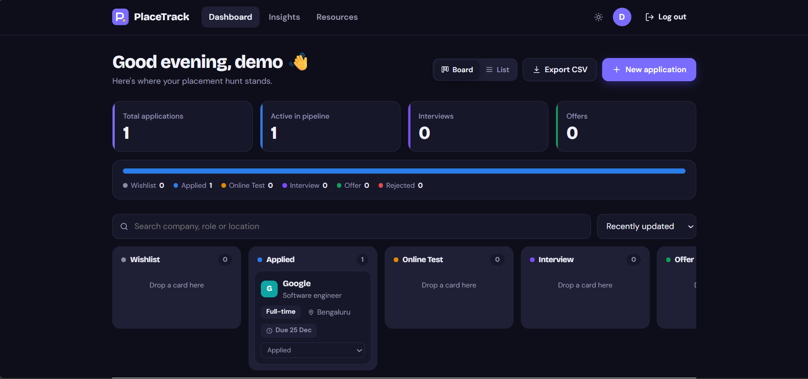
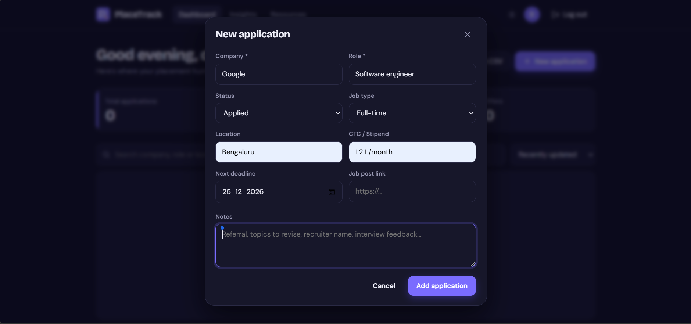
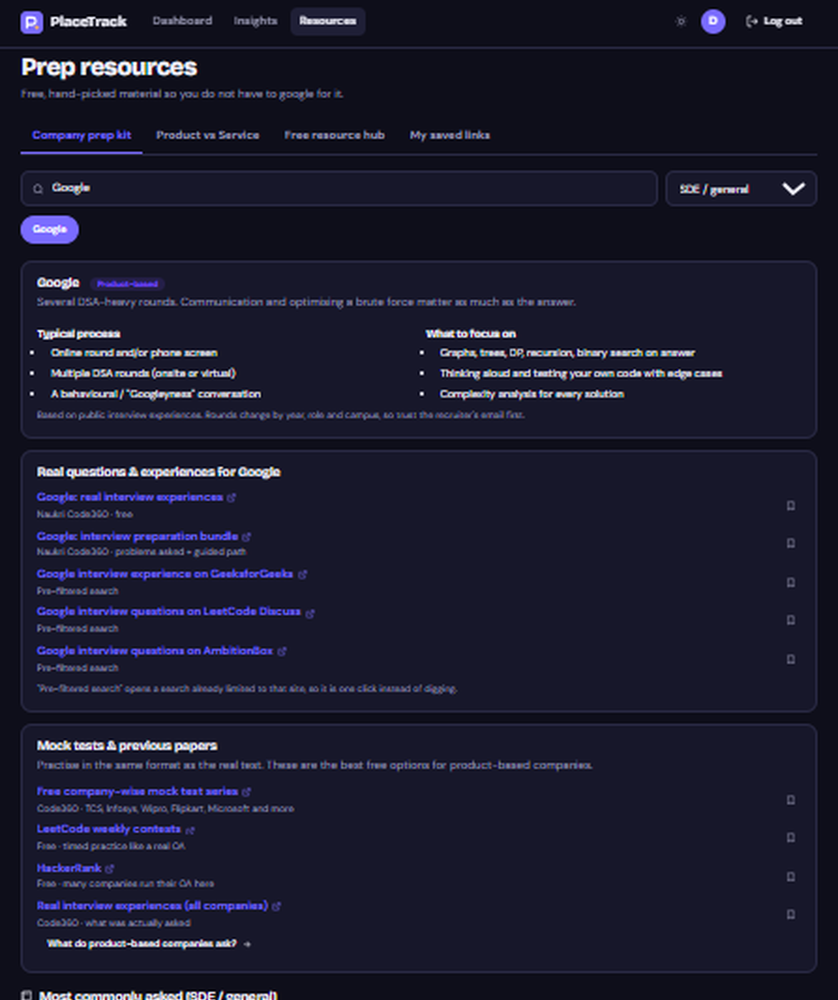

# PlaceTrack

**Track every application. Land the offer.**

PlaceTrack is a full-stack MERN app that helps students manage their placement season: campus drives, off-campus applications, online tests, interviews and offers, all in one dashboard.

## Live Demo

- **App:** [https://placetrack-lgpc.onrender.com](https://placetrack-lgpc.onrender.com)
- **API:** [https://placetrack-backend-bwyg.onrender.com](https://placetrack-backend-bwyg.onrender.com)

> The backend runs on Render's free plan, so the first request after a period of inactivity can take 50 seconds or more.

## Features

- Secure auth: signup/login with bcrypt-hashed passwords and JWT (7-day expiry)
- Full CRUD for applications: company, role, status, job type, location, CTC, deadline, job link, notes
- Six-stage pipeline: Wishlist, Applied, Online Test, Interview, Offer, Rejected
- Kanban board view with drag and drop, plus a list view
- Change status in one click right from the card
- Live dashboard stats and a pipeline breakdown bar
- Deadline highlighting (due today, due in N days, overdue)
- Search, filter by status, sort by recent / deadline / company
- Export your applications to CSV
- Insights page with application analytics
- Resources page with company prep kits, mock tests, commonly asked questions and saved links
- Light and dark themes (remembers your choice)
- Responsive layout, toasts, loading and empty states, delete confirmation
- Per-user data isolation: users can only read, edit or delete their own applications

## Screenshots









## Tech Stack

| Layer               | Technology                                                                 |
| ------------------- | -------------------------------------------------------------------------- |
| Frontend            | React 18, React Router 6, Context API, plain CSS (design tokens, no UI library) |
| Backend             | Node.js, Express                                                           |
| Database            | MongoDB + Mongoose                                                         |
| Auth and validation | JSON Web Tokens, bcryptjs, express-validator                               |
| Deployment          | Render, MongoDB Atlas                                                      |

## Project Structure

```text
placetrack/
├── backend/            # Express API (routes, models, middleware, seed script)
├── public/             # Static assets
├── src/
│   ├── components/     # Landing, AuthForm, Dashboard, ApplicationCard, ApplicationModal ...
│   ├── context/        # AuthContext, ApplicationContext, ToastContext
│   ├── api.js          # fetch wrapper (auth header, error handling)
│   └── config.js       # app name, statuses (rename the product here)
└── package.json        # Frontend dependencies and scripts
```

## Run Locally

### Prerequisites

- Node.js 18+ and npm
- MongoDB (local) or a MongoDB Atlas URI

### 1. Clone and install

```bash
git clone https://github.com/Pratishthakum/placetrack.git
cd placetrack
npm run install:all
```

### 2. Set environment variables

Create `backend/.env`:

```env
PORT=5000
MONGO_URI=your_mongodb_connection_string
JWT_SECRET=your_long_random_secret
CLIENT_ORIGIN=http://localhost:3000
```

Create `.env` in the project root:

```env
REACT_APP_API_URL=http://localhost:5000
```

> Never commit `.env` files.

### 3. (Optional) Load demo data

```bash
npm run seed
```

Demo login: `demo@placetrack.dev` / `demo1234`

### 4. Start the app

```bash
npm run dev
```

The frontend runs at `http://localhost:3000` and the API at `http://localhost:5000`.

## Scripts

| Command          | Description                               |
| ---------------- | ----------------------------------------- |
| `npm run dev`    | Start frontend and backend together       |
| `npm start`      | Start the frontend only                   |
| `npm run server` | Start the backend only                    |
| `npm run build`  | Create a production build of the frontend |
| `npm run seed`   | Load demo data into the database          |

## API

All `/api/applications` routes need the header `auth-token: <jwt>`.

| Method | Route                      | Description            |
| ------ | -------------------------- | ---------------------- |
| POST   | `/api/auth/createuser`     | Register, returns JWT  |
| POST   | `/api/auth/login`          | Login, returns JWT     |
| GET    | `/api/auth/getuser`        | Current user           |
| GET    | `/api/applications`        | List my applications   |
| POST   | `/api/applications`        | Create                 |
| PUT    | `/api/applications/:id`    | Update (owner only)    |
| DELETE | `/api/applications/:id`    | Delete (owner only)    |

## Security Notes

- Passwords are hashed with bcrypt; JWT secret lives in `.env`, never in code.
- Every query includes `{ _id, user: req.user.id }`, so a foreign id simply returns 404.
- Server-side validation with express-validator and enum-checked Mongoose schemas.

## Deployment

| Service                       | Settings                                                                                       |
| ----------------------------- | ---------------------------------------------------------------------------------------------- |
| Backend (Render Web Service)  | Root directory `backend`, build `npm install`, start `npm start`                               |
| Frontend (Render Static Site) | Build `npm install && npm run build`, publish directory `build`, rewrite `/*` to `/index.html` |
| Database                      | MongoDB Atlas                                                                                  |

## Roadmap

- [ ] Email reminders before deadlines (node-cron + Nodemailer)
- [ ] Pagination, refresh tokens, automated tests

## Author

[Pratishthakum](https://github.com/Pratishthakum)
